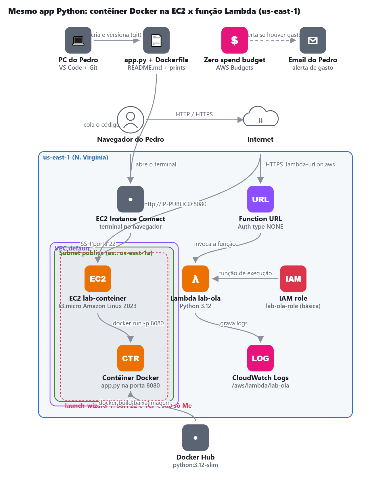
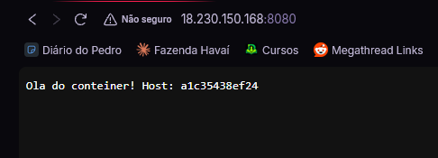
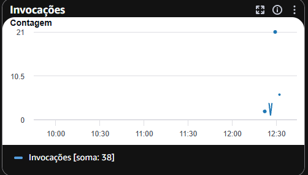

# AWS Lab 08 — Contêiner no EC2 e Lambda: mesmo app, 2 formas de rodar

Laboratório 8 da minha trilha de estudos para a **AWS Certified Cloud Practitioner (CLF-C02)**.

## Objetivo

Executar a mesma aplicação Python em um contêiner Docker hospedado em uma instância Amazon EC2 e como uma função AWS Lambda, comparando os dois modelos de execução e identificando seus principais casos de uso.

## Arquitetura

## O que eu fiz

- [x] Conferi o alerta de orçamento e selecionei a região `sa-east-1`.
- [x] Verifiquei a instalação do Python e do Git no computador.
- [x] Configurei meu nome e e-mail no Git.
- [x] Criei a pasta do projeto e o arquivo `app.py`.
- [x] Criei o Dockerfile para definir a construção da imagem Docker.
- [x] Inicializei o repositório Git e verifiquei os arquivos não rastreados.
- [x] Lancei a instância EC2 `lab-conteiner` com Docker instalado via User Data.
- [x] Conectei à EC2 e verifiquei a instalação do Docker.
- [x] Criei os arquivos `app.py` e `Dockerfile` na instância.
- [x] Construí a imagem Docker e executei o contêiner.
- [x] Acessei a aplicação pelo navegador.
- [x] Criei a função Lambda `lab-ola` com a mesma lógica da aplicação Python.
- [x] Configurei a Function URL e testei a função pelo navegador.
- [x] Documentei as diferenças entre EC2 com Docker e AWS Lambda.
- [x] Realizei a limpeza dos recursos e conferi o Billing.

## Prints

### Instância EC2 com Docker + Python

### Função Lambda

### Registro CloudWatch

## Comparação dos modelos

| Característica | EC2 + Docker | AWS Lambda |
|---|---|---|
| Modelo de execução | Contêiner em servidor virtual | Função serverless |
| Gerenciamento de servidor | Responsabilidade do usuário | Gerenciado pela AWS |
| Escalabilidade | Configurada conforme a necessidade | Gerenciada automaticamente |
| Execução | Contínua enquanto o contêiner estiver ativo | Sob demanda, em resposta a eventos ou requisições |
| Cobrança | Instância EC2 provisionada por tempo de uso | Solicitações e duração da execução, conforme o modelo de cobrança |
| Caso de uso | Aplicações que precisam de ambiente persistente e maior controle | Aplicações sob demanda, APIs e processamento de eventos |

## O que aprendi

- Como executar uma aplicação Python em um contêiner Docker.
- Como utilizar o Amazon EC2 para hospedar uma aplicação conteinerizada.
- Como executar uma lógica equivalente utilizando AWS Lambda.
- As diferenças entre infraestrutura provisionada e computação serverless.
- Como comparar modelos de execução, escalabilidade e cobrança na AWS.
- Como utilizar User Data para automatizar a configuração de uma instância EC2.

## Domínio da prova

Domínio 3 — Tecnologia e serviços de nuvem (AWS Certified Cloud Practitioner — CLF-C02).

## Limpeza — prevenção de custos

- [x] Excluí a Function URL e a função Lambda.
- [x] Encerrei (Terminate) a instância EC2.
- [x] Excluí o Security Group criado, caso não esteja em uso.
- [x] Verifiquei se existem volumes EBS não utilizados.
- [x] Verifiquei se existem Elastic IPs alocados.
- [x] Conferi o AWS Billing para identificar possíveis recursos remanescentes.
